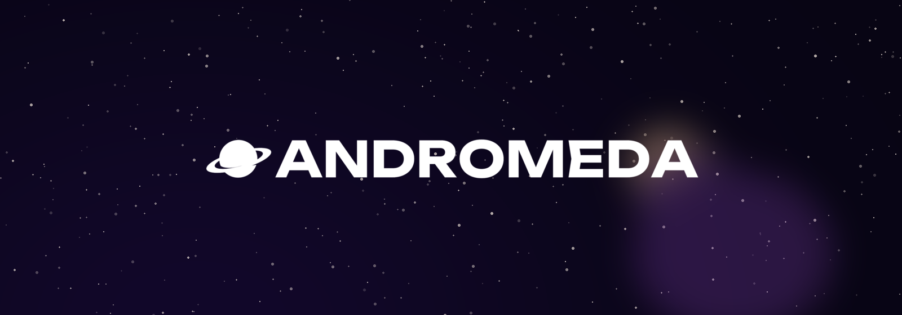
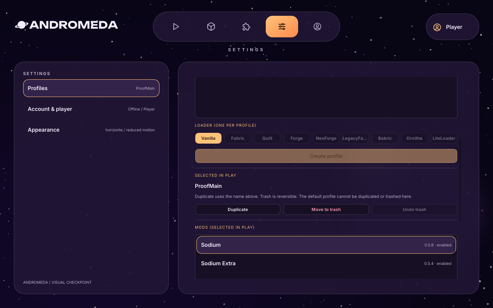

<p align="center">
  
</p>

<p align="center">
  
  
  
  
</p>

# Andromeda

A Minecraft Java launcher for Windows, written in Rust with a native Slint interface. Andromeda is an [Andromeda Labs](https://github.com/4DRI4N-OFF) project and is currently in private development: no public release yet.

## Preview

<p align="center">
  
</p>

*Development build, Horizonte theme: profile creation with the one-loader-per-profile picker and the mods panel. Captured from the active feature branch; not merged into main yet.*

## What works today (main)

- Play installed vanilla (1.21.11) offline with a local profile, from the UI or the CLI.
- Verified downloader for vanilla versions and Java.
- Isolated instances: create, deep-duplicate, and a recoverable trash with restore.
- Animated logo intro; click skips it, and the saved Reduce animations setting skips it entirely.
- Dark mode and reduced-motion preference, persisted between runs.
- Microsoft sign-in with protected session storage is integrated; phase 4 validation is still in progress.
- Windows CI on every push and PR: `fmt`, `clippy -D warnings`, the test suite and a full build.

*Feature behavior was validated on the development PC during phases 1 to 4; the phase documents below record exactly what was checked. Development builds ship as pre-releases under [Releases](https://github.com/4DRI4N-OFF/Andromeda-Launcher/releases).*

## In active development

These live on unmerged feature branches and are not on main yet:

- **Theme engine.** One layout with three themes: Horizonte (deep-space violet), Alba (light) and Cartógrafo (charcoal and bronze), with animated switching.
- **Full version catalog.** Every Minecraft release, snapshot and old alpha/beta with filters, and exactly one loader per instance (Vanilla, Fabric, Quilt, Forge, NeoForge and legacy chains), limited to loader versions compatible with the chosen game version. Install and launch-plan generation are verified on a Windows PC; a full in-game launch from this branch is not verified yet.
- **Native splash and startup transition** into the main window.
- **Mod manager**, planned after the version catalog lands.

## Under the hood

- **Microsoft sign-in security.** Authorization code + S256 PKCE against Microsoft's hosted page in an isolated WebView2 window; no client secret, no injected JavaScript, no credential capture. Only the refresh token is persisted, protected with Windows current-user DPAPI plus app-specific entropy. Access tokens stay in memory, secret-bearing types have no `Debug`/`Serialize`, and logs are scanned for token-shaped values. Details and limits in [PHASE4.md](PHASE4.md).
- **Custom-drawn controls.** Buttons, rows, fields and switches are drawn in Slint instead of platform widgets, so the launcher's own theme applies regardless of the Windows theme. `ScrollView` is the only standard widget left.
- **The intro is data, not a video player.** 181 lossless QOI frames decoded straight into Slint's RGBA buffer, timed by elapsed time so a busy machine does not stretch it. Details in [INTRO.md](INTRO.md).
- **Instance isolation.** Each instance keeps its own game directory; duplicating is a deep copy, and trashing moves instead of deleting, so a mistake is recoverable. See [PHASE3.md](PHASE3.md).
- **Translation-ready.** All UI strings go through Slint's `@tr()`, so catalogs can be added without touching layout. English is the only supplied locale today.
- **Visual proofs in CI.** A manual workflow renders screens offscreen on a Windows runner and uploads the captures as artifacts, so layout changes can be reviewed without a local run.

## Building from source

Requires Windows and a stable Rust toolchain.

```powershell
cargo fmt --all -- --check
cargo clippy --workspace --all-targets -- -D warnings
cargo test --workspace
cargo build --workspace
```

UI: `target/debug/andromeda.exe`. Downloader: `target/debug/andromeda-download.exe list` or `install 1.21.11`.

Runtime data stays in the source workspace's `data` folder (including protected auth session data under `data/auth`). Do not commit downloaded game assets, Java binaries, settings, logs or auth/session data.

## Documentation

- [PHASE1.md](PHASE1.md): vanilla download and install
- [PHASE2.md](PHASE2.md): offline play
- [PHASE3.md](PHASE3.md): isolated instances and trash
- [PHASE4.md](PHASE4.md): Microsoft sign-in and session safety
- [INTRO.md](INTRO.md): logo intro pipeline

## Language and contributions

English is the default for UI, documentation, comments, commits, PRs and release notes.

Every change lands through its own branch and pull request, merges once it is reviewed and the checks pass, and ships as a GitHub pre-release with notes on what changed and what was verified. The repository stays private: no public release without the owner's approval.

## Disclaimer

Not an official Minecraft product. Not affiliated with Mojang or Microsoft. Downloading game files does not grant a Minecraft license. Project licensing is not yet decided.
